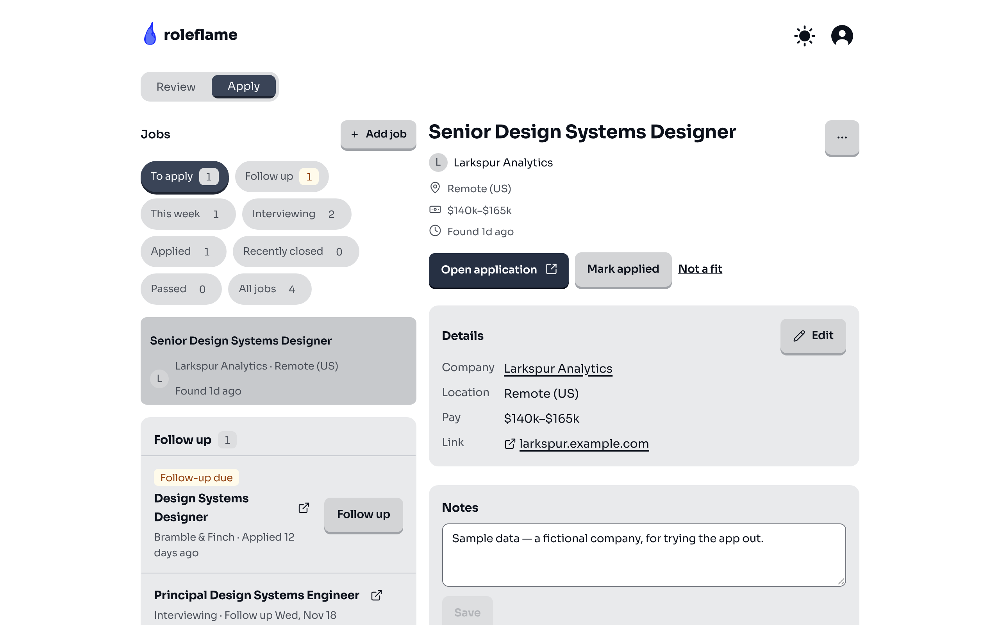
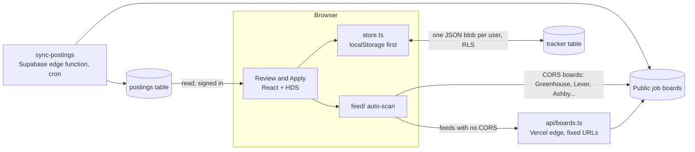

# roleflame

A job-application tracker and discovery board for design-systems roles.



**Live:** https://roleflame.vercel.app · **Demo, no account:** https://roleflame.vercel.app/#/review?demo=1

roleflame collects design-system openings from public job boards into one list, **Review**, where
you save or skip each posting. Saved jobs go to **Apply**, which tracks each one through applying
and following up. Apply works signed out, in the browser, and Scan now in the Account menu reads
postings without an account. Signing in adds the automatic scan, the server's scheduled board sync,
and sync across devices.

## Stack

- Vite, React 19 and TypeScript.
- [`@hirobius/design-system`](https://github.com/hirobius/hds) (HDS) for every UI element.
- Supabase for sign-in and sync (one row per user, row-level security).
- Vitest and Playwright for tests. Vercel for hosting.

## Run it

```bash
npm ci            # needs HDS_PACKAGES_TOKEN, see CONTRIBUTING.md
npm run dev       # http://localhost:5173
npm run verify    # typecheck, lint, HDS check, unit tests, build
npm run test:e2e  # Playwright browser tests
```

## How it works



- **Local first.** Every edit writes to `localStorage` at once (`src/store.ts`, one external store
  read with `useSyncExternalStore`). Signed in, `src/account/` syncs the whole state as one
  versioned JSON blob per user. Merges are three-way against the last synced copy, so a delete
  stays deleted on every device.
- **Two sources of postings.** The browser scans the job boards the user follows. A scheduled
  Supabase function scans a wider board list into `postings`. Both pass the same design-systems
  check (`src/tracks/`, shared with the server).
- **Safety rails.** A strict CSP lists every host the app may call (`vercel.json`, pinned by
  `src/csp.test.ts`). Every table has row-level security. Nothing syncs before the sign-in guard
  has run for that user.
- **UI from HDS only.** Screens use HDS components and tokens. Where HDS has no answer yet, a
  small stand-in lives in `src/hds-gaps/`, and each one is listed with its upstream ask in
  [`docs/hds-upstream-asks-0.9.md`](docs/hds-upstream-asks-0.9.md), to be deleted when HDS ships
  the fix.

## Structure

- `src/`: the app. `App.tsx` is the shell, `store.ts` the data store, `route.ts` the router.
- `src/feed/`: reads and matches postings from public job boards.
- `src/account/`: sign-in, sync, backup and restore.
- `src/tracks/`: scoring and dedupe, shared with the server sync.
- `supabase/`: migrations and the scheduled sync function.
- `api/`: one Vercel edge function, a proxy for job boards with no CORS.
- `e2e/`: Playwright tests. `scripts/`: build and check tools.
- `docs/`: [decision records](docs/adr/), [agent docs](docs/agent/README.md), specs and research.

## Decisions

Each hard-to-reverse choice has a record in [`docs/adr/`](docs/adr/). Start with these:

- [0005](docs/adr/0005-consume-hds-directly-from-public-npm.md): use the design system straight
  from public npm, and [0007](docs/adr/0007-track-hds-latest-with-the-upgrade-tool.md): stay on its
  latest release with its upgrade tool.
- [0008](docs/adr/0008-sync-user-edited-stores-in-blob-v5.md): everything the user edits syncs in
  one blob.
- [0010](docs/adr/0010-two-screens-find-and-apply.md): two screens, Review and Apply, with the
  selection in the URL.

Domain words are in [`CONTEXT.md`](CONTEXT.md). Also: [`SECURITY.md`](SECURITY.md),
[`SUPABASE_SETUP.md`](SUPABASE_SETUP.md).

## Contributing

See [`CONTRIBUTING.md`](CONTRIBUTING.md). Agents start at [`CLAUDE.md`](CLAUDE.md).

## License

All rights reserved. No license is granted.
