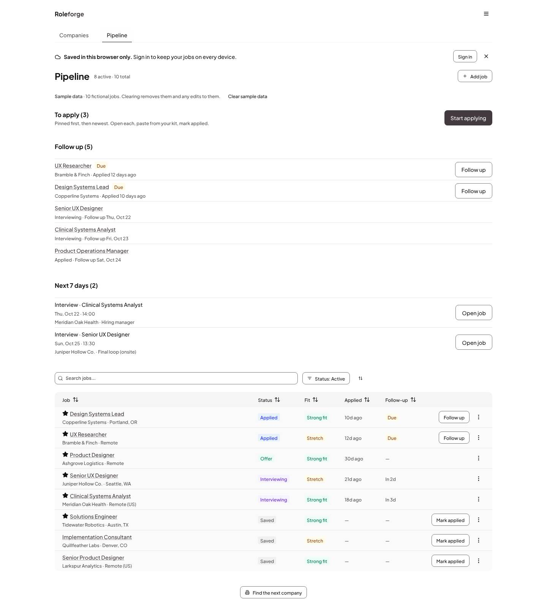
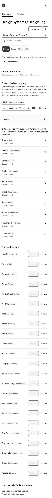
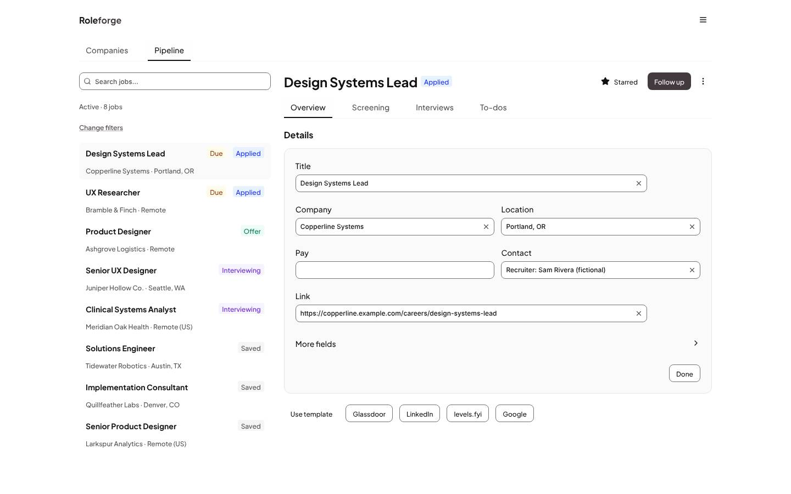
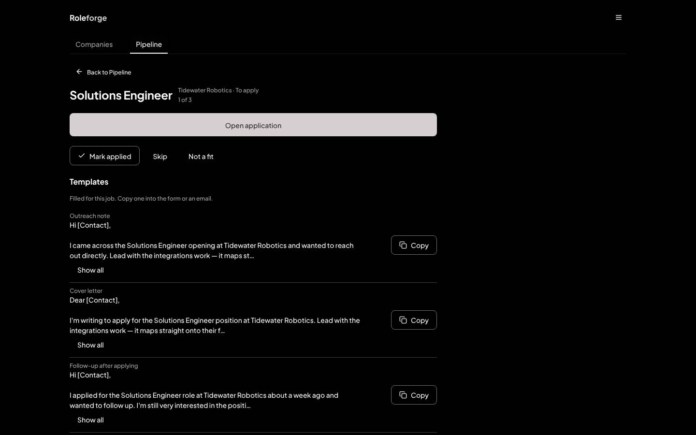

# Roleforge redesign, 2026: case study

From a tracker that had accreted features to a set of screens that read as one designed product.
Pure HDS (0.24.1, graphite accent), no local UI layer, held by tests rather than by memory.

## Problem

The 2026-10-13 audit (68 shots, light and dark, 1440 and 390) found: a job page that was a form; a sync
nudge and a sample-data band stacked above every first heading (620px down on a phone); Discover
tiles inside a second padded surface; Templates as a stack of editors; 130 inline styles and no
guard; uneven Pipeline cards; Today rows 380px away from their actions; a clipped top tab at 390.

## Constraints

Pure HDS: no MUI-style `sx` engine, no local primitive layer, no colour override, sentence case. No
store, sync, route or CSP changes in the polish pass. Verification is local; no CI service.

## Decisions

### Round 1: one designed product (2026-10-13)

- Top tabs (Today, Pipeline, Discover, Templates) with Today as home; the job page is its own view.
- Graphite accent over jade: one accent, no local colour remap.
- Location belongs to the track, not to every search panel.
- One async pattern (`hds-gaps/AsyncState`) and one empty-state pattern.
- Banners are not page furniture: the sync nudge became one line and the sample-data notice a
  one-line note under the page header.
- Section heads use the body step; the title step is for the page.
- Ratcheting guards: an inline-style ceiling, no inline font size or weight, zero lint warnings,
  composed contrast pairs, axe on every route, a 40px touch probe, no uppercase, no running motion
  under reduced motion.

### Round 2: the calm list (2026-10-20, PR #257)

Living with round 1 showed that four tabs was one decision too many before any work started, and
that Today and the Pipeline answered the same question ("what do I do next?") in two places.

- Two tabs, **Companies** and **Pipeline**. Companies is home; Templates left the tab bar and opens
  from the Apply sheet and the Menu.
- **Today is gone.** Its follow-ups and next 7 days head the Pipeline, under To apply, so the one
  list a person returns to holds every next step. `#/today` redirects.
- **Flat rows, not cards.** Agenda sections, phone job rows, company lists, Templates and loading
  skeletons are rows on the page with hairlines between them. Cards stay only where they hold a form
  or a choice (job details, onboarding picks).
- **Rhythm from Stack gaps, never margins:** 24 under a heading, 48 between sections.
- **Header:** a one-letter mark on a phone, the wordmark from `sm` up, set at body size so the page
  title is always the largest text.
- **Apply sheet:** Apply mode lists every template already filled for the job, one copy row each,
  so applying is open, copy, mark applied, next.

## Before and after

Before is the 2026-10-13 audit; after is `main` at the calm list, fictional sample data. The full
set (98 shots, light and dark, 1440 and 390) comes from `npm run gallery`.

| | Before | After |
|---|---|---|
| Home, 1440, light: Today, then the Pipeline that absorbed it |  |  |
| Pipeline, 390, light |  |  |
| Discover, then Companies, 390, light |  |  |
| Pipeline, 1440, dark |  |  |

New in round 2:

| Job page, 1440, light | Apply mode, 1440, dark |
|---|---|
|  |  |

## What the product taught HDS

Every place HDS fell short has a stand-in in `src/hds-gaps/` or `src/theme/base.css` that names
its ask and is deleted when HDS ships the fix. Shipped upstream so far: the dark pressed-accent
contrast (hds#748, in HDS 0.27) and the tabs overflow cue (hds#723).

| Stand-in | What HDS lacks | Ask |
|---|---|---|
| `ActionToast` | Toast with action buttons (Open, Undo) | Toast `actions` |
| `AsyncState` | One component for loading, error with Retry, empty, ready | `AsyncState` pattern |
| `RailList` | A list of links with one marked current | `NavList` / selectable `ListItem` |
| `TokenTextarea` | A text field whose `[Variable]` tokens are atomic chips | `TokenField` |
| `TabsOverflowFade` | An edge cue on overflowing Tabs and SegmentedControl | hds#723 (closed; drop on upgrade) |
| `useBreakpoint` | A hook to read an HDS breakpoint in JS | `useBreakpoint` |
| `useVisualViewportVars` | A Dialog or Sheet that stays above the phone keyboard | hds#690 (Sheet) |
| `barePanel` | A bare `TabsContent` for top-level navigation | `TabsContent variant="bare"` |
| `tone.SECONDARY` | A tone prop on `Text`; a danger tone on `Menu.Item` | hds#655 |
| `base.css` active tab | The active tab's underline never shows | hds#749 |
| `base.css` 40px controls | A touch size for small controls on coarse pointers | hds#750 |
| nested `&` in `sx` | A base breakpoint in `sx` | hds#652 |
| `EmptyState.tsx` | An action slot on `EmptyState` | hds#654 |

## Measurements

- Inline `style={{` in non-test `.tsx`: 130 (audit), 96 (round 1), 83 now; the ratchet in
  `hdsOnly.test.ts` fails if the count rises or drops without lowering the ceiling.
- Lint warnings: 7 (audit) to 0; `npm run lint` fails on any.
- axe (WCAG A and AA): zero violations on every route, Apply mode included, light and dark, 1440
  and 390 (`e2e/a11y.spec.ts`).
- Phone touch targets under 40px: 120+ on the first run, 0 now.
- Bundle (gzip, `npm run build`, 2026-10-20): index 68.8 kB, react 45.6 kB, vendor 137.9 kB,
  supabase 57.5 kB, vendor CSS 20.5 kB. Discover, Companies, Live postings and Templates are lazy
  chunks of 6 to 9 kB each.
