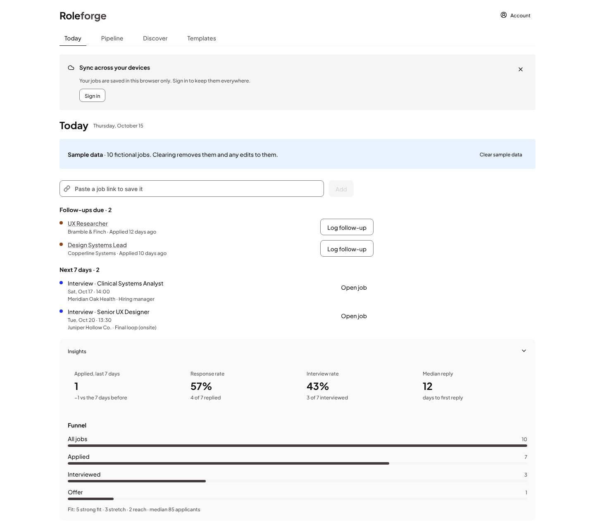
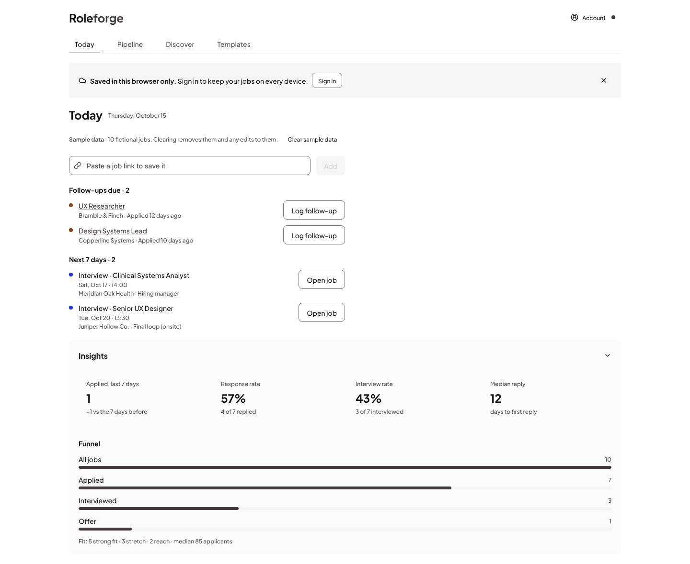
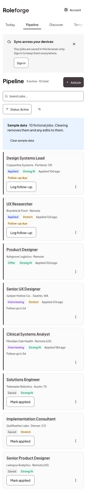
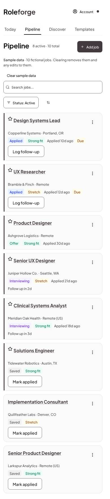
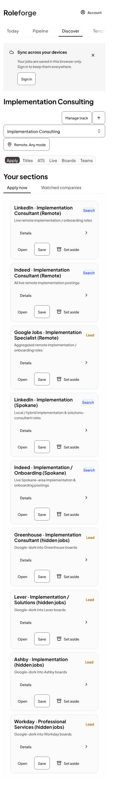
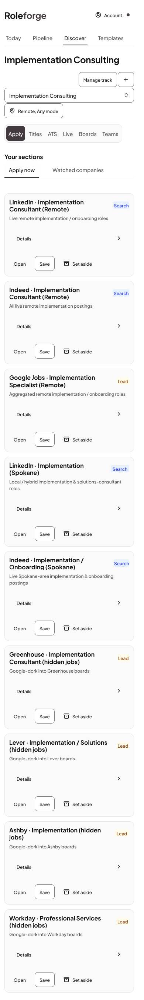
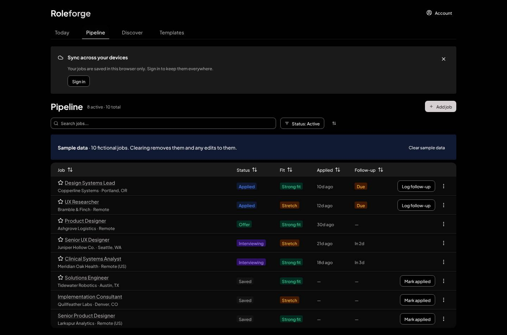
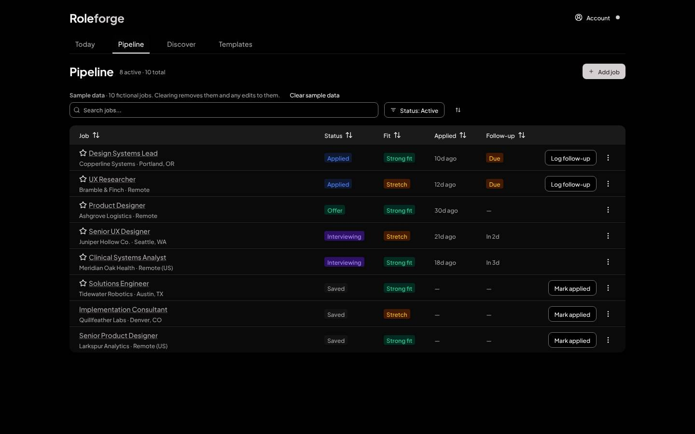

# Roleforge redesign, 2026: case study

From a tracker that had accreted features to a set of screens that read as one designed product.
Pure HDS (0.24.1, graphite accent), no local UI layer, held by tests rather than by memory.

## Problem

The 2026-10-13 audit (68 shots, light and dark, 1440 and 390) found: a job page that was a form; a sync
nudge and a sample-data band stacked above every first heading (620px down on a phone); Discover
tiles inside a second padded surface; Templates as a stack of editors; 130 inline styles and no
guard; uneven Pipeline cards; Today rows 380px away from their actions; a clipped top tab at 390.

## Constraints

Pure HDS: no MUI-style `sx` engine, no local primitive layer, no colour override, sentence case. No
store, sync, route or CSP changes in the polish pass. Verification is local; no CI service.

## Decisions

- Top tabs (Today, Pipeline, Discover, Templates) with Today as home; the job page is its own view.
- Graphite accent over jade: one accent, no local colour remap.
- Location belongs to the track, not to every search panel.
- One async pattern (`hds-gaps/AsyncState`) and one empty-state pattern.
- Banners are not page furniture: the sync nudge is one line on Today and a dot on the Account
  trigger elsewhere; the sample-data notice is a one-line note under the page header.
- Section heads use the body step; the title step is for the page.
- Ratcheting guards: an inline-style ceiling, no inline font size or weight, zero lint warnings,
  composed contrast pairs, axe on every route, a 40px touch probe, no uppercase, no running motion
  under reduced motion.

## Before and after

| | Before | After |
|---|---|---|
| Today, 1440, light |  |  |
| Pipeline, 390, light |  |  |
| Discover, 390, light |  |  |
| Pipeline, 1440, dark |  |  |

## What HDS gained (filed or noted as asks)

A tone prop and a weight prop on `Text` (hds#655), a base breakpoint in `sx` (hds#652), an action slot
on `EmptyState` (hds#654), a tab and segmented-control overflow cue, a metric-tile row that wraps, a
touch size for sm controls, a fix for the missing active-tab underline, and a lift for the dark
pressed-accent contrast (held at a 3.0:1 floor in `theme.contrast.test.ts`). Each stand-in sits in
`src/hds-gaps/` or `base.css` and names its ask.

## Measurements

- Inline `style={{` in non-test `.tsx`: 130 (audit) to 96.
- Lint warnings: 7 (audit) to 0; `npm run lint` now fails on any.
- axe (WCAG A and AA): zero violations on 10 routes, light and dark, 1440 and 390.
- Phone touch targets under 40px: 120+ reported on first run, 0 now.
- Bundle (gzip, `npm run build`): index 56.7 kB, react 45.6 kB, vendor 137.5 kB, supabase 57.5 kB,
  vendor CSS 20.5 kB.
